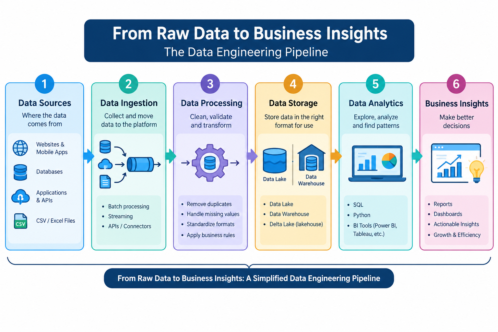

# Behind Every Insight, There Is Data Engineering

### Understanding Data Engineering Foundations and Getting Started with Databricks

## 1. Introduction: What Happens to Data Before It Becomes an Insight?

Imagine ordering your favorite product online. You search for the product, add it to your cart, make a payment, and track your delivery.

Have you ever wondered what happens to all this information after you place your order?

Every action generates data. The e-commerce platform must collect information from orders, payments, customers, inventory, and delivery systems. But raw data alone cannot tell a business whether sales are increasing, which products are popular, or why customers are cancelling orders.

Before this information can become a meaningful business insight, it must be collected, processed, organized, and made available for analysis.

This is where **Data Engineering** plays an important role.

As someone learning Data Analytics, I wanted to understand what happens behind the scenes before data reaches a dashboard. In this article, I will explain the fundamentals of Data Engineering, its importance in business, the differences between Data Engineers and Data Analysts, and how beginners can get started with Databricks.

## 2. What Is Data Engineering?

Data Engineering is the process of designing, building, and maintaining systems that collect, transform, store, and deliver data so that it can be used reliably for analytics, reporting, and other applications.

In simple words, Data Engineering prepares data so that businesses can use it effectively.

### What Does a Data Engineer Do?

A Data Engineer is responsible for building and maintaining the systems that move data from different sources to suitable storage and analytical environments.

Common responsibilities include:

- Collecting data from databases, applications, APIs, and files.
- Building data pipelines to move data between systems.
- Cleaning and transforming raw data.
- Managing data storage and organization.
- Monitoring pipelines and resolving failures.
- Improving data quality, reliability, and processing performance.
- Making trusted data available to analysts and other teams.

### Where Does Data Come From?

Businesses generate data from many sources, including:

- E-commerce websites and mobile applications.
- Banking transactions and payment systems.
- Food delivery and transportation applications.
- Customer relationship management systems.
- Sensors and Internet of Things devices.
- Website activity and social media interactions.
- CSV files, Excel spreadsheets, and databases.

### Real-World Example: An E-Commerce Company

Suppose an online shopping company receives thousands of orders every hour.

Its data may include customer details, product information, order amounts, payment statuses, and delivery updates.

A Data Engineer builds pipelines that collect information from these systems, validate and transform the records, and organize the resulting data for reporting.

A Data Analyst can then use the prepared data to answer questions such as:

- Which products generate the most revenue?
- Which region has the highest number of orders?
- Why are order cancellations increasing?
- Which months have the highest sales?

This shows how Data Engineering helps turn raw records into useful information.

## 3. How Does Data Move From Raw Records to Business Insights?

A typical data workflow includes the following stages:

**Data Sources → Data Ingestion → Data Processing → Data Storage → Data Analysis → Business Insights**

Each stage has a specific purpose.

**1. Data Sources:** Information originates from applications, databases, transaction systems, and files.

**2. Data Ingestion:** Data is collected and moved into a data platform, either in batches or through streaming systems.

**3. Data Processing:** Data is validated, cleaned, standardized, and transformed into a useful format.

**4. Data Storage:** Processed data is stored in systems such as data warehouses or data lakes, depending on the architecture.

**5. Data Analysis:** Analysts explore the data using SQL, Python, Excel, or Power BI.

**6. Business Insights:** Reports and dashboards help decision-makers identify trends and take informed action.

For example, an online retailer can use this workflow to identify its best-selling products and improve inventory planning.

### Original Diagram: The Data Engineering Pipeline



*Diagram caption: A simplified view of how raw data moves through a data engineering pipeline to support business decisions.*

This is a conceptual pipeline. Actual architectures can include additional stages, orchestration, quality checks, security controls, and monitoring.

## 4. Why Do Businesses Need Data Engineering?

Imagine a retail company that stores customer and sales records in different systems. Some records contain missing values, customer details are inconsistent, and the same transaction appears more than once.

If the company uses this data without checking its quality, the sales report may be inaccurate.

For example, duplicate transactions could inflate reported revenue, while missing order records could cause the company to underestimate sales.

Data Engineering helps businesses address these problems.

### Common Problems With Poorly Managed Data

**1. Duplicate Records**

The same order may appear multiple times, leading to incorrect sales calculations.

**2. Missing Values**

Missing customer, product, or transaction details can affect reporting and analysis.

**3. Inconsistent Formats**

Dates, currencies, product names, and customer identifiers may be represented differently across systems.

**4. Slow Reporting**

When data is scattered across multiple sources, collecting and processing it manually can take significant time.

**5. Unreliable Business Decisions**

Incorrect or incomplete data can lead managers to make decisions based on misleading results.

### How Data Engineering Helps

Data Engineering helps by building repeatable pipelines, applying validation rules, standardizing data formats, managing storage, and monitoring processing jobs.

For example, an e-commerce pipeline can check for missing order IDs, standardize dates, identify duplicate transactions, and ensure that the resulting dataset follows defined quality rules.

Data quality is not only about cleaning records. It also involves making data accurate, consistent, complete, timely, and suitable for its intended use.

### What Is a Data Pipeline?

A data pipeline is a sequence of processes that moves data from a source to a destination and may transform it along the way.

Pipelines can run on a schedule, respond to new data, or process information continuously.

For example, a retail company might run a pipeline every night to update its sales tables. The next morning, its analysts can use the refreshed data to prepare reports.

Reliable pipelines reduce repetitive manual work and help make reporting more consistent.

## 5. Data Engineer vs. Data Analyst

Data Engineers and Data Analysts work together, but their primary responsibilities differ.

A Data Engineer focuses on making data available and reliable. A Data Analyst focuses on understanding the data and communicating findings.

Consider a retail company whose monthly sales have declined.

The Data Engineer checks whether the required sales data is being collected correctly, resolves pipeline issues, and prepares reliable datasets.

The Data Analyst then investigates sales trends, compares product categories and regions, and identifies possible reasons for the decline.

### Comparison Table

| Category               | Data Engineer                                          | Data Analyst                                                      |
| ---------------------- | ------------------------------------------------------ | ----------------------------------------------------------------- |
| Primary responsibility | Build and maintain data systems                        | Analyze data and generate insights                                |
| Main objective         | Deliver reliable, accessible data                      | Support business decisions                                        |
| Typical tasks          | Data ingestion, transformation, pipeline monitoring    | Data cleaning, exploration, reporting                             |
| Common tools           | SQL, Python, Apache Spark, Databricks, cloud platforms | SQL, Excel, Python, Power BI, Tableau                             |
| Typical outputs        | Data pipelines, curated datasets, data tables          | Reports, dashboards, charts, recommendations                      |
| Business contribution  | Improves data availability and reliability             | Explains performance and supports decisions                       |
| Key questions          | Is the data available and trustworthy?                 | What happened, why did it happen, and what should we investigate? |

*Note: Tools and responsibilities vary by organization. Some roles overlap.*

### How Do They Work Together?

The Data Engineer prepares a trusted sales dataset containing order dates, product categories, quantities, revenue, and order statuses.

The Data Analyst uses that dataset to calculate monthly revenue, compare product performance, and investigate changes in customer purchasing behavior.

Together, they help the company move from raw records to actionable business information.

## 6. Understanding OLTP vs. OLAP

Two important concepts in data systems are OLTP and OLAP.

### What Is OLTP?

OLTP stands for Online Transaction Processing.

OLTP systems are designed to handle everyday business transactions, such as placing an order, transferring money, or recording a payment.

For example, when a customer purchases a product, the e-commerce system records the order and updates its status.

### What Is OLAP?

OLAP stands for Online Analytical Processing.

OLAP systems are designed to support analytical queries that explore data across multiple dimensions, often using historical information.

For example, a retail manager may analyze three years of sales to compare revenue by month, region, and product category.

### Comparison Table

| Category           | OLTP                                            | OLAP                                             |
| ------------------ | ----------------------------------------------- | ------------------------------------------------ |
| Full form          | Online Transaction Processing                   | Online Analytical Processing                     |
| Main purpose       | Process daily transactions                      | Analyze data for insights                        |
| Typical operations | Insert, update, and retrieve individual records | Aggregate, summarize, and compare large datasets |
| Data focus         | Current operational transactions                | Historical and analytical data                   |
| Typical users      | Customers and operational applications          | Analysts, managers, and decision-makers          |
| Example            | Recording an online order                       | Analyzing yearly sales trends                    |

The two systems serve different purposes. OLTP supports daily operations, while OLAP supports analysis. A business may use both within its broader data architecture.

## 7. Getting Started With Databricks

Databricks is a data and AI platform that supports data engineering, analytics, and machine learning workflows.

It provides tools for working with data, running code, building pipelines, and collaborating with other team members.

For beginners, three useful concepts to understand are Workspace, Compute, and Notebooks.

### A. What Is a Databricks Workspace?

A Databricks Workspace is an environment where users can organize and access resources for their data projects.

Depending on the workspace configuration and permissions, these resources may include notebooks, files, queries, dashboards, and other project-related objects.

Think of a Workspace as a digital office for data work.

Imagine a team working on an e-commerce analytics project. Team members can organize notebooks for data cleaning, SQL analysis, and reporting-related tasks in the workspace.

A well-organized workspace makes it easier to manage projects and collaborate.

### B. What Is Compute in Databricks?

Compute refers to the resources used to execute code and process data.

Writing code and executing code are two different activities.

When you write a Python statement in a notebook, you are defining an instruction. When you execute that statement, compute resources perform the operation and return a result.

For example, a notebook may contain Python code that reads a dataset, removes duplicate records, and calculates total sales. The code needs suitable compute resources to run.

**A real-world analogy:**

Imagine writing a recipe for a dish.

The written recipe contains the instructions, but you still need a kitchen, equipment, and ingredients to prepare the dish.

Similarly, notebook code contains instructions, while compute provides the resources needed to execute them.

The exact compute options available depend on your Databricks environment, workspace configuration, and permissions.

### C. What Is a Databricks Notebook?

A Databricks Notebook is an interactive environment where users can write and execute code, document their work, and examine results.

Notebooks can support languages such as Python and SQL, depending on the notebook configuration and available platform features.

A notebook is organized into cells. Each cell can contain code or, where supported, explanatory text.

For example, a beginner exploring an e-commerce dataset might use separate cells to:

1. Import the required libraries.
2. Load the dataset.
3. Display the first few rows.
4. Check the number of records and columns.
5. Identify missing values.
6. Remove duplicate records.
7. Calculate total sales.
8. Display the results.

Keeping these steps in separate cells makes the workflow easier to understand, execute, and debug.

### A Simple Example

Suppose a dataset contains order IDs, product names, quantities, and prices.

The following Python code calculates the total value of the order items:

```python
import pandas as pd

data = {
    "Product": ["Laptop", "Headphones", "Mouse"],
    "Quantity": [2, 3, 5],
    "Price": [50000, 2000, 500]
}

df = pd.DataFrame(data)

df["Sales"] = df["Quantity"] * df["Price"]

print(df)
print("Total Sales:", df["Sales"].sum())
```

The expected total sales value is **₹1,08,000**.

This example uses a small in-memory dataset to demonstrate the basic idea. Real Databricks projects may use larger datasets and distributed processing tools such as Apache Spark.

For a beginner, notebooks provide a practical way to learn how code transforms data and produces results.

## 8. Connecting Everything in a Real Business

Let's connect these concepts using an online retail company.

Every day, customers place orders, make payments, and receive deliveries. The company generates data across multiple applications and databases.

First, data engineering pipelines collect the relevant information.

Next, processing steps validate the records, handle duplicates, standardize formats, and organize the data for analysis.

The data is then stored in an appropriate analytical environment.

A platform such as Databricks can support the development and execution of data processing workflows. Engineers may use notebooks and suitable compute resources to explore, transform, and process datasets.

Once reliable data is available, a Data Analyst can use SQL, Python, or Power BI to investigate business performance.

For example, the analyst might discover that sales have declined in a particular product category or that cancellations have increased in one region.

The business can then investigate the underlying causes and decide what action to take.

This illustrates the relationship between Data Engineering, data platforms, and Data Analytics.

**Data Engineering prepares the foundation. Data Analytics helps turn that foundation into business understanding.**

## 9. What I Learned From This Exploration

While exploring Data Engineering and Databricks, I learned that business insights depend on more than charts and dashboards.

Behind a useful report, there may be multiple data sources, processing steps, quality checks, storage systems, and pipelines.

I also learned that Data Engineers and Data Analysts have different but complementary responsibilities. Engineers help make data reliable and accessible, while analysts investigate patterns and communicate findings.

Understanding Workspace, Compute, and Notebooks also helped me understand how a data platform supports practical data work.

As a learner building my foundation in Data Analytics, I believe that understanding Data Engineering will help me work more effectively with datasets and understand the processes behind analytical results.

I am excited to continue learning SQL, Python, data processing, and Databricks through practical projects.

## 10. Conclusion

Data Engineering plays an important role in helping organizations manage growing volumes of data and make it useful for analysis.

From online shopping and banking to food delivery and streaming, reliable data workflows help businesses organize information and support informed decisions.

Understanding the difference between Data Engineers and Data Analysts, the purpose of OLTP and OLAP, and the fundamentals of Databricks provides a strong starting point for anyone entering the data industry.

For beginners, the best way to learn is to combine conceptual understanding with hands-on practice.

Every meaningful insight starts with data, but reliable processes help turn that data into something businesses can trust.

**Behind every insight, there is data engineering.**

## References and Learning Resources

1. Databricks Documentation — [https://docs.databricks.com/](https://docs.databricks.com/)
2. Databricks Academy — [https://www.databricks.com/learn/training](https://www.databricks.com/learn/training)
3. Apache Spark Documentation — [https://spark.apache.org/docs/latest/](https://spark.apache.org/docs/latest/)
4. Microsoft Learn: Data Analytics — [https://learn.microsoft.com/en-us/training/powerplatform/power-bi/](https://learn.microsoft.com/en-us/training/powerplatform/power-bi/)
5. IBM: What Is Data Engineering? — [https://www.ibm.com/think/topics/data-engineering](https://www.ibm.com/think/topics/data-engineering)

These resources provide additional information about data platforms, data processing, and analytics. Review the relevant documentation before publishing to ensure that your article reflects the current features and terminology.
